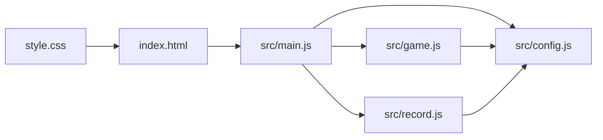

# Design: Chuva de Bugs

## Visão geral
O jogo será uma página estática com uma área Canvas 2D de tamanho fixo, centralizada e apresentada sobre um fundo escuro. O jogador controla o dev por teclado enquanto cafés e bugs caem, e a dificuldade aumenta durante a partida. A aplicação terá três estados: início, jogando e fim de jogo. O recorde será guardado no navegador e continuará disponível em partidas futuras.

## Decisões técnicas
| Decisão | Escolha | Por quê |
|---|---|---|
| Renderização | Canvas 2D e emojis desenhados com `fillText` | Atende ao visual definido sem imagens ou dependências. |
| Organização | HTML, CSS e módulos JavaScript nativos, em 6 arquivos | Segue a stack fixa e mantém o projeto pequeno. |
| Atualização do jogo | Um loop com `requestAnimationFrame` e delta time em segundos | Mantém movimento e dificuldade consistentes entre quadros. |
| Colisões | Comparação retangular entre os limites do dev e de cada item | É suficiente para os objetos simples e fácil de conferir. |
| Surgimento dos itens | Posição horizontal aleatória e chance igual para café e bug | É a interpretação mais simples de posições variadas e tipos de item. |
| Recorde | `localStorage`, com leitura ao abrir e gravação ao superar o valor anterior | Preserva o recorde no mesmo navegador sem login ou serviço online. |

## Arquitetura


## Estrutura de arquivos
```text
index.html          Estrutura da página e área acessível do jogo.
style.css           Fundo, centralização e dimensões visuais da área.
src/main.js         Inicialização, teclado, loop, desenho e apresentação dos estados.
src/config.js       Valores ajustáveis reunidos no objeto CONFIG.
src/game.js         Estado da partida, movimento, itens, colisões e dificuldade.
src/record.js       Leitura e gravação do recorde no navegador.
```

## Componentes
### `index.html`: Página do jogo
- **Responsabilidade:** Criar a página, disponibilizar a área Canvas com nome acessível e carregar `src/main.js` por caminho relativo.
- **Estado:** Nenhum; o estado pertence aos módulos JavaScript.
- **Funções principais:** Nenhuma.
- **Atende:** 1.1, 1.2, 2.1, 5.2, 6.1

### `style.css`: Apresentação da página
- **Responsabilidade:** Centralizar a área fixa do jogo e aplicar o fundo escuro com aparência de editor de código.
- **Estado:** Nenhum.
- **Funções principais:** Nenhuma.
- **Atende:** 1.1, 5.2, 6.1

### `src/main.js`: Entrada e apresentação
- **Responsabilidade:** Inicializar módulos, tratar teclado, executar o loop, desenhar os estados e atualizar a exibição da pontuação e das vidas.
- **Estado:** Estado do teclado (`left` e `right` iniciam em `false`), último horário do quadro e instância do estado da partida.
- **Funções principais:** `handleKeyDown(event)`: inicia ou reinicia com Espaço e atualiza teclas de movimento; `handleKeyUp(event)`: libera teclas; `draw(state, context)`: desenha a tela conforme o estado atual; `frame(timestamp)`: calcula delta time, atualiza a partida, trata fim de jogo, desenha e agenda o próximo quadro.
- **Atende:** 1.1, 1.2, 2.1, 5.2, 5.3, 6.1, 6.2, 7.2

### `src/config.js`: Configuração central
- **Responsabilidade:** Exportar o objeto `CONFIG` com valores de ajuste usados pelos demais módulos.
- **Estado:** Nenhum estado mutável.
- **Funções principais:** Nenhuma.
- **Atende:** 2.1, 2.2, 3.1, 3.2, 3.3, 4.1, 4.2, 5.1

### `src/game.js`: Regras da partida
- **Responsabilidade:** Criar e atualizar o estado do jogo, movimentar o dev, criar e atualizar itens, detectar colisões, remover itens perdidos e encerrar a partida.
- **Estado:** Fase (`start`, `playing` ou `gameover`), pontuação, vidas, posição do dev, itens ativos, tempo de partida e temporizadores de surgimento.
- **Funções principais:** `createGameState()`: cria o estado inicial; `startGame(state)`: inicia ou reinicia a partida sem apagar o recorde; `updateGame(state, input, deltaTime)`: aplica movimento, surgimentos, quedas, colisões e aumento de dificuldade.
- **Atende:** 1.2, 2.2, 3.1, 3.2, 3.3, 3.4, 4.1, 4.2, 5.1, 6.1, 6.2

### `src/record.js`: Persistência do recorde
- **Responsabilidade:** Carregar o recorde ao abrir o jogo e gravar um novo valor apenas quando a pontuação final for maior.
- **Estado:** Nenhum; usa o armazenamento do navegador.
- **Funções principais:** `loadRecord()`: lê e valida o recorde salvo; `saveRecord(score, currentRecord)`: retorna e salva o maior valor entre a pontuação e o recorde atual.
- **Atende:** 6.1, 7.1, 7.2, 7.3

## Configuração central (`CONFIG` em `src/config.js`)
| Constante | Valor inicial | Para que serve | Atende |
|---|---:|---|---|
| `canvasWidth` | 640 px | Largura fixa da área de jogo. | 2.2 |
| `canvasHeight` | 480 px | Altura fixa da área de jogo. | 2.2 |
| `playerWidth` | 48 px | Largura de colisão do dev. | 2.2, 3.2, 3.3 |
| `playerHeight` | 48 px | Altura de colisão do dev. | 3.2, 3.3 |
| `playerSpeed` | 300 px/s | Velocidade horizontal do dev. | 2.1 |
| `itemSize` | 32 px | Tamanho de desenho e colisão dos itens. | 3.1, 3.2, 3.3 |
| `initialLives` | 3 | Vidas no começo de cada partida. | 5.1 |
| `coffeePoints` | 1 | Pontos ganhos ao coletar café. | 3.2 |
| `initialItemSpeed` | 120 px/s | Velocidade inicial de queda. | 4.1 |
| `itemSpeedIncrease` | 4 px/s² | Aumento da velocidade de queda ao longo do tempo. | 4.1 |
| `maxItemSpeed` | 360 px/s | Limite de velocidade para manter os itens jogáveis. | 4.1 |
| `initialSpawnInterval` | 1,2 s | Intervalo inicial entre itens. | 3.1, 4.2 |
| `minSpawnInterval` | 0,35 s | Menor intervalo entre itens. | 4.2 |
| `spawnIntervalDecrease` | 0,015 s/s | Redução do intervalo conforme o tempo passa. | 4.2 |
| `coffeeChance` | 0,5 | Chance de um item ser café; o restante será bug. | 3.1 |
| `playerEmoji` | `🧑‍💻` | Emoji usado para desenhar o dev. | 1.1 |
| `coffeeEmoji` | `☕` | Emoji usado para desenhar cafés. | 3.1 |
| `bugEmoji` | `🐛` | Emoji usado para desenhar bugs. | 3.1 |
| `startKey` | `Space` | Tecla para iniciar e repetir uma partida. | 1.2, 6.2 |
| `leftKeys` | `ArrowLeft`, `a` | Teclas para mover o dev à esquerda. | 2.1 |
| `rightKeys` | `ArrowRight`, `d` | Teclas para mover o dev à direita. | 2.1 |
| `recordStorageKey` | `chuvaDeBugsRecord` | Chave de armazenamento do recorde. | 7.1, 7.3 |
| `colors` | Fundo `#111827`, texto `#e5e7eb`, destaque `#34d399` | Cores de fundo, textos e destaque do jogo. | 1.1, 5.2, 6.1 |

## Fluxo

```mermaid
stateDiagram-v2
    [*] --> inicio
    state "Tela inicial" as inicio
    state "Jogando" as jogando
    state "Fim de jogo" as fim
    inicio --> jogando: "Espaço"
    jogando --> fim: "vidas chegam a zero"
    fim --> jogando: "Espaço; nova partida"
```


No carregamento, `main.js` prepara o Canvas, carrega o recorde e inicia a tela inicial. Em cada quadro, calcula o delta time e, se a partida estiver ativa, chama `updateGame` com o estado do teclado. `updateGame` movimenta o dev dentro da área, atualiza os temporizadores, cria e move itens, resolve colisões e remove os itens que chegaram ao chão. A velocidade de queda aumenta com o tempo até o limite configurado, enquanto o intervalo de surgimento diminui até seu mínimo. Se as vidas chegarem a zero, `main.js` grava um novo recorde quando aplicável e desenha a tela final; por fim, o quadro desenha a tela atual e agenda o próximo.

## Propriedades de corretude
- Para qualquer quadro, a posição horizontal do dev permanece dentro da área de jogo. (Valida: 2.2)
- Para qualquer item, no máximo uma consequência de colisão é aplicada antes de ele ser removido. (Valida: 3.2, 3.3, 3.4)
- Para qualquer partida, a pontuação não fica negativa e as vidas permanecem entre zero e três. (Valida: 3.2, 3.3, 5.1)
- Para qualquer partida em andamento, velocidade de queda e frequência de surgimento não diminuem com o tempo. (Valida: 4.1, 4.2)
- Para qualquer estado de fim de jogo, as vidas são zero e a pontuação final permanece disponível para exibição. (Valida: 6.1)
- Para qualquer gravação, o recorde salvo nunca fica abaixo do recorde anterior. (Valida: 7.1, 7.3)

## Casos limite
- Se as duas direções forem pressionadas ao mesmo tempo, o movimento horizontal do dev será zero.
- Se o jogador mantiver Espaço pressionado, a repetição automática da tecla não iniciará várias partidas.
- Se um item tocar o dev e o chão no mesmo quadro, a colisão com o dev será resolvida antes da remoção por chegada ao chão.
- Se vários bugs forem coletados em sequência, cada item reduzirá as vidas uma única vez; ao chegar a zero, a partida termina no mesmo quadro.
- Se o recorde salvo estiver ausente ou inválido, o jogo começa com recorde zero.
- Se o armazenamento do navegador não estiver disponível, a partida continua, mas o recorde não poderá ser preservado após fechar a página.